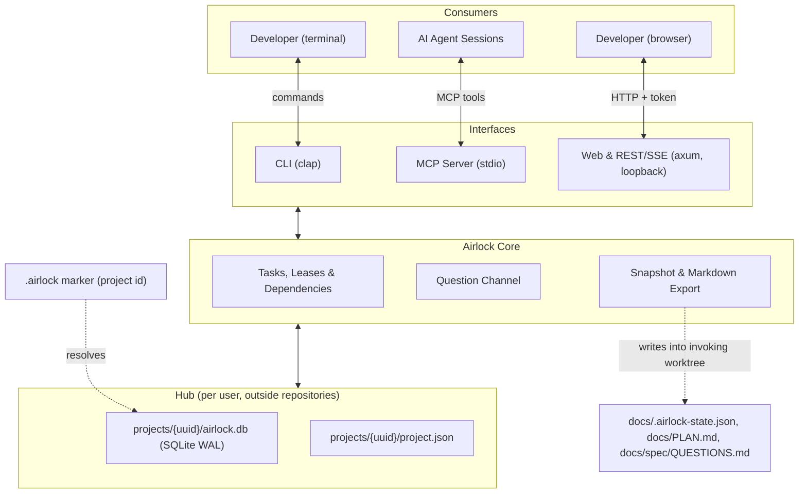

# Project Overview: Airlock

---

## What It Is

**Airlock** is a local-first coordinator for projects in which several AI agent sessions and human developers work concurrently, often across git worktrees. It keeps tasks, questions, and session leases in one store outside the repository and exposes them through a CLI, an MCP server for agents, and a local web dashboard. Hand-edited plan files are replaced by generated, conflict-tolerant exports.

---

## Project Stats

- **Language:** Rust (edition 2024, MSRV 1.85)
- **Interfaces:** CLI (`clap`); planned: MCP over stdio, local web server (`axum`)
- **Persistence (planned):** one SQLite database (WAL) per project in the hub directory (`~/.local/state/airlock/projects/<uuid>/` on Linux), referenced from the repository by a `.airlock` marker file
- **Status:** scaffold — see [`docs/plans/PHASE_PLAN.md`](docs/plans/PHASE_PLAN.md)
- **License:** MIT

---

## Architectural Decisions

### 1. Single Binary, Dual Interface
- **Decision:** One Rust binary contains the CLI, the MCP stdio server (`airlock mcp`), and the dashboard server (`airlock serve`).
- **Rationale:** Installable once (`cargo install`) and usable with any project's tech stack; agents and humans use the same tool and the same rules.

### 2. Hub Store Outside the Repository
- **Decision:** Live state lives in SQLite (WAL mode) in a per-user hub directory, not in the repository. Projects reference it through a committed, immutable `.airlock` marker containing only the project id.
- **Rationale:** Each git worktree has its own working tree, so a repo-local database would fork per worktree. A hub store is shared by all worktrees and sessions on the machine. No daemon: each invocation opens the database, runs one immediate transaction with conditional state transitions, and exits.
- **Scope:** one machine per project state in v0.x; multi-machine sync is a separate future design.

### 3. Derived Readiness
- **Decision:** Only `open / in_progress / in_review / done` is stored. `blocked` vs. `ready` and the "unblocks" relation are derived from `blocked_by` on every read.
- **Rationale:** Redundant stored state drifts; derived state cannot.

### 4. Canonical Snapshot, Generated Views
- **Decision:** `airlock sync` writes a byte-stable JSON snapshot (the only import source) and Markdown views into the invoking worktree. Session state (claims, leases) is not exported. Generated files are never hand-resolved; a hash-based guard refuses to overwrite snapshots this hub did not produce.
- **Rationale:** Git keeps a reviewable, restorable history of the plan without day-to-day merge conflicts, and a snapshot from another machine cannot be silently clobbered.

### 5. Airlock Boundary as Structure, Not Enforcement
- **Decision:** Questions and prose answers form a recorded channel between sessions; MCP servers bound to clean-room roles expose a restricted tool set.
- **Rationale:** This prevents accidental leaks by cooperating agents and leaves an audit trail. Session ids are self-declared, so hard isolation is delegated to the environment (separate OS user, container, sandbox).

### 6. Local-Only Web Server
- **Decision:** The dashboard binds to loopback only and requires a per-start token; Host and Origin headers are checked. Airlock never executes a task's `verify` command.
- **Rationale:** A state-mutating local HTTP API is otherwise reachable from any website via CSRF or DNS rebinding.

---

## Detailed Architecture

---

## Source Files

### `src/`
- [`src/main.rs`](src/main.rs): Entry point; parses the CLI. Commands currently exit with "not implemented yet".
- [`src/lib.rs`](src/lib.rs): Library root and module declarations.
- [`src/cli.rs`](src/cli.rs): Complete CLI definition (Spec 02) with global `--project`, `--session`, `--json`.
- [`src/core.rs`](src/core.rs): Domain model — `Task`, `TaskState`, derived `TaskStatus`, leases, `Question`, dependency graph validation.
- [`src/config.rs`](src/config.rs): Hub-side project configuration (`ProjectConfig`, `RoleConfig`, `ExportConfig`).
- [`src/snapshot.rs`](src/snapshot.rs): Canonical JSON snapshot model, serializer, and import validation.

### `tests/`
- [`tests/model.rs`](tests/model.rs): Derived status, leases, dependents, graph validation, config defaults.
- [`tests/snapshot.rs`](tests/snapshot.rs): Golden-file test pinning the exact snapshot bytes; session state exclusion; round trip.
- [`tests/cli.rs`](tests/cli.rs): Documented invocations parse; clap definition consistency.
- [`tests/common/mod.rs`](tests/common/mod.rs): Shared fixtures.

### `docs/`
- [`docs/spec/`](docs/spec/README.md): Specifications 01–05.
- [`docs/plans/PHASE_PLAN.md`](docs/plans/PHASE_PLAN.md): Implementation phases.
- [`docs/plans/ROADMAP.md`](docs/plans/ROADMAP.md): Milestones.
- [`docs/walkthroughs/quickstart.md`](docs/walkthroughs/quickstart.md): User walkthrough.

---

## Dependencies

All dependencies are locked in [`Cargo.lock`](Cargo.lock).

| Dependency | Purpose |
|---|---|
| `clap` (4.6, `derive`, `env`) | CLI parsing; environment fallbacks for `AIRLOCK_PROJECT` / `AIRLOCK_SESSION` |
| `serde` (1.0) | Serialization framework |
| `serde_json` (1.0) | Snapshot, config, MCP, and `--json` output |
| `anyhow` (1.0) | Error propagation in the binary |

Planned: `rusqlite` (Phase 1), `axum` and `rust-embed` (Phase 4).

---

## References

- Model Context Protocol specification: https://modelcontextprotocol.io
