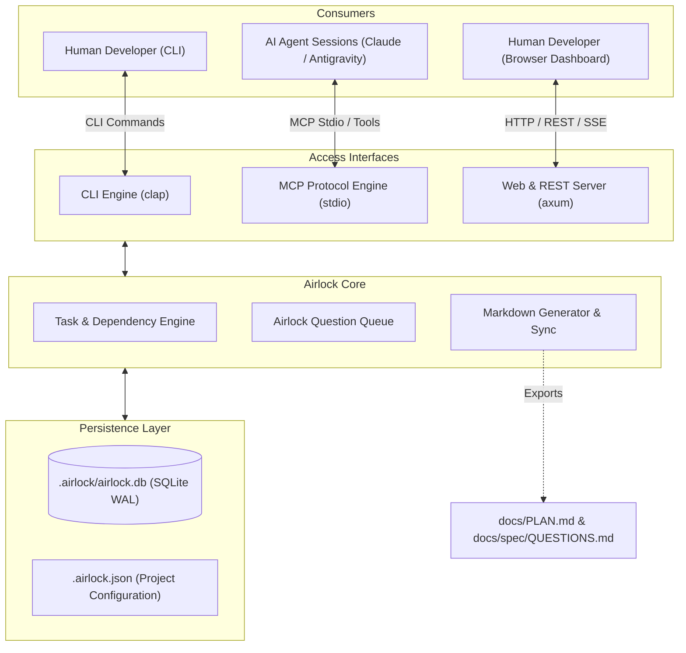

# Project Overview: Airlock

---

## What it is?

**Airlock** is a universal, local-first multi-agent workflow coordinator and task management hub written in Rust. It eliminates merge conflicts, token waste, and coordination overhead in projects where multiple AI agent sessions and human developers work concurrently across distinct roles or git worktrees.

It replaces fragile, monolithic markdown roadmaps with an atomic, concurrent task and question store while providing dual interfaces: native Model Context Protocol (MCP) tools for AI agents and a command-line interface (CLI) with an embedded web dashboard for developers.

---

## Project Stats

- **Language:** Rust (Edition 2024, Rust 1.98+)
- **Primary Interfaces:** CLI (`clap`), MCP (stdio JSON-RPC), Web Server (`axum` embedded)
- **Persistence:** Local SQLite with WAL mode (`.airlock/airlock.db`)
- **License:** MIT
- **Repository Location:** `/home/peter/Projects/airlock`
- **Current Branch:** `feat/initial-scaffold-and-specs`

---

## Architectural Decisions

### 1. Standalone Single Binary Architecture
- **Decision:** Airlock is built as an independent, zero-runtime-dependency binary in Rust.
- **Rationale:** A single binary can be installed globally (`cargo install`) and used across any software project regardless of the target project's tech stack (Rust, Python, TypeScript, C++, etc.).

### 2. Dual Interface (CLI + MCP) in One Executable
- **Decision:** Both the CLI subcommands and the MCP server stdio loop reside in the same binary.
- **Rationale:** AI agents can be launched pointing directly to `airlock mcp` via their configuration, while humans and CI scripts invoke `airlock task ...` without needing two different tools.

### 3. SQLite with Write-Ahead Logging (WAL)
- **Decision:** Use an embedded SQLite database as the primary source of truth for live task status, locks, and questions.
- **Rationale:** Unlike JSON or Markdown files that lock the entire file during writes, SQLite WAL allows concurrent readers and writers across different git worktrees and shell sessions without file corruption or race conditions.

### 4. Deterministic Markdown Export Layer
- **Decision:** Decouple live state from Git by exporting database state to Markdown (`docs/PLAN.md`, `docs/spec/QUESTIONS.md`) only upon demand (`airlock sync`) or commit hooks.
- **Rationale:** Developers retain human-readable progress documents in git history without suffering day-to-day merge conflicts from concurrent sessions modifying the same line numbers.

### 5. Clean-Room Boundary Protocol (The "Airlock")
- **Decision:** Structured question-and-answer entity (`Question`) separated from implementation code.
- **Rationale:** Clean-room implementation sessions (e.g. Engine) must never directly access decompiled or proprietary sources; their questions are answered purely in behavioral prose and committed specs.

---

## Detailed Architecture

---

## Source Files Description

### Source Directory (`src/`)
- [`src/lib.rs`](file:///home/peter/Projects/airlock/src/lib.rs): Library root, module definitions, and version export.
- [`src/main.rs`](file:///home/peter/Projects/airlock/src/main.rs): Application entry point, CLI argument parsing (`clap`), and command dispatch.
- [`src/config.rs`](file:///home/peter/Projects/airlock/src/config.rs): Project configuration model (`ProjectConfig`, `RoleConfig`, `ExportConfig`).
- [`src/core.rs`](file:///home/peter/Projects/airlock/src/core.rs): Domain entities (`Task`, `Question`, `TaskStatus`, `QuestionStatus`).

### Tests (`tests/`)
- [`tests/smoke_test.rs`](file:///home/peter/Projects/airlock/tests/smoke_test.rs): Smoke test suite verifying serialization, deserialization, and default configurations.

### Documentation (`docs/`)
- [`docs/spec/README.md`](file:///home/peter/Projects/airlock/docs/spec/README.md): Index of technical specifications.
- [`docs/spec/01_architecture_and_data_model.md`](file:///home/peter/Projects/airlock/docs/spec/01_architecture_and_data_model.md): Detailed data structures and lifecycle states.
- [`docs/spec/02_cli_interface.md`](file:///home/peter/Projects/airlock/docs/spec/02_cli_interface.md): Specification of command-line syntax and behavior.
- [`docs/spec/03_mcp_protocol.md`](file:///home/peter/Projects/airlock/docs/spec/03_mcp_protocol.md): Model Context Protocol tools and schemas.
- [`docs/spec/04_web_dashboard_and_api.md`](file:///home/peter/Projects/airlock/docs/spec/04_web_dashboard_and_api.md): Specification of the REST API, SSE, and embedded Kanban UI.
- [`docs/spec/05_git_sync_and_airlock.md`](file:///home/peter/Projects/airlock/docs/spec/05_git_sync_and_airlock.md): Clean-room boundary enforcement and git synchronization strategy.
- [`docs/plans/PHASE_PLAN.md`](file:///home/peter/Projects/airlock/docs/plans/PHASE_PLAN.md): Step-by-step development phases.
- [`docs/plans/ROADMAP.md`](file:///home/peter/Projects/airlock/docs/plans/ROADMAP.md): High-level feature roadmap and releases.
- [`docs/walkthroughs/quickstart.md`](file:///home/peter/Projects/airlock/docs/walkthroughs/quickstart.md): Step-by-step user onboarding guide.

---

## Dependencies and Their Purpose

All dependencies are locked to exact versions in [`Cargo.lock`](file:///home/peter/Projects/airlock/Cargo.lock).

| Dependency | Purpose |
|---|---|
| `clap` (4.6.7) | High-performance command-line argument parser with derive macro support. |
| `serde` (1.0.229) | Generic serialization and deserialization framework. |
| `serde_json` (1.0.154) | JSON data format serializer and parser for MCP protocol and configuration. |
| `anyhow` (1.0.104) | Ergonomic error handling and context propagation across CLI commands. |

---

## Additional References

- Model Context Protocol (MCP) Specification: https://modelcontextprotocol.io
- OpenSHR Project Reference: Clean-room separation workflow defined in `/home/peter/Projects/openshr/docs/PROCESS.md`.
