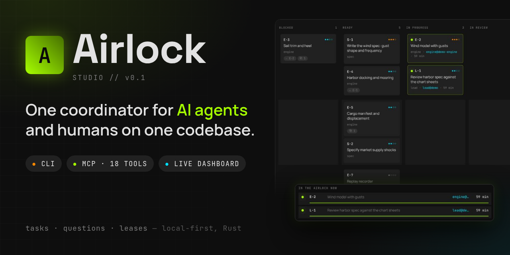
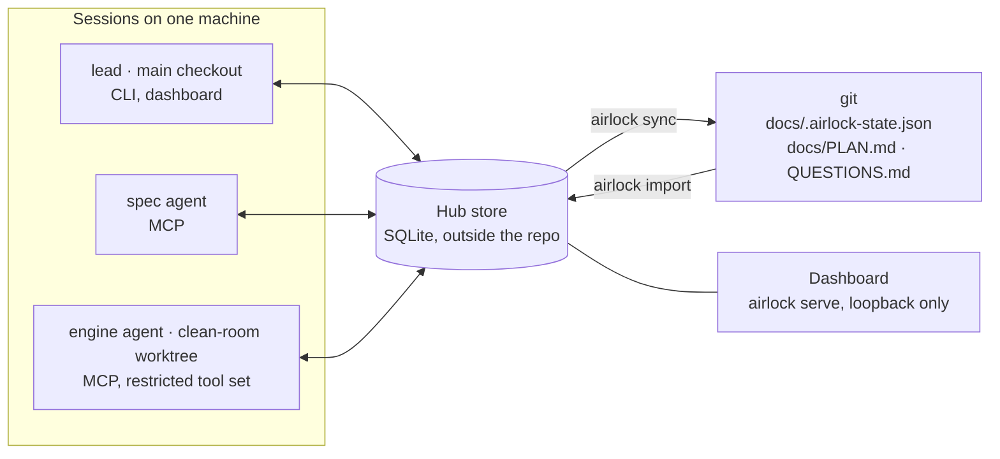

<div align="center">

# Airlock

**A local-first coordinator for AI agents and humans working on one codebase.**

Tasks, questions, and leases in one store shared by every worktree of a project —
a CLI for people, an MCP server for agents, and a live dashboard for both.

[](https://github.com/Pappet/airlock/actions/workflows/ci.yml)
[](LICENSE)
[](Cargo.toml)
[](docs/spec/03_mcp_protocol.md)



</div>

---

## The problem

Several agent sessions and a few humans work on one project, usually in separate git worktrees. They coordinate through a hand-edited `PLAN.md`: it conflicts on every merge, every agent has to read the whole plan to find one task, nobody knows who is working on what, and a clean-room session has no structured way to ask the spec a question.

## What Airlock does instead

| Hand-edited `PLAN.md` | Airlock |
|---|---|
| One file in git, merge conflicts on every change | **One SQLite store per project, outside the repo** — every worktree and session on the machine sees the same state; plan files in git become generated exports |
| Agent reads the whole plan to find a task | **Compact work packages** — *Read, Touch, Do, Verify* — handed out one at a time by `task next` |
| "Who is on this?" is a guess | **Leases** — a claimed task belongs to one session; a crashed session's lease expires |
| Readiness tracked by hand | **Derived readiness** — a task is ready when its `blocked_by` prerequisites are done |
| Everything has the same priority | **Tracks** with a priority scale (`critical` › `high` › `normal` › `low`); agents get the most important ready work first |
| Questions get lost in chat | **A question channel** between implementation and spec sessions, answered once, exported to git with an audit trail |
| Each agent configured by hand | **Onboarding** — worktrees bound to roles, a session briefing agents read first, `doctor` and `setup` for the harness config |

Scope of v0.x: one machine per project state. Clean-room features structure and record the exchange between sessions; actual isolation (separate user, container, sandbox) comes from the environment — see [Spec 05 §4](docs/spec/05_git_sync_and_airlock.md#4-the-airlock-boundary).

## How it works



Every agent starts its session with a briefing — its rules, its claimed work, the answers to its questions, and what to do next:

```markdown
# Airlock session briefing

Project **tidewater** · session `engine@demo-engine` · role **engine** (clean-room)

## Rules
Implement only from the specifications listed in your work packages. Never read
analysis material. If a specification is unclear, ask a question instead of guessing.

## Your claimed work

### E-2 — Wind model with gusts (lease: 60 min left)
- **Track:** Navigation · **Priority:** high
- **Read:** `docs/spec/wind.md`
- **Touch:** `src/sim/wind.rs`
- **Do:** Base wind from the weather table plus gusts as specified
- **Verify:** cargo test wind
- **Progress:** Base wind done; gust envelope in progress.

## Answers to your questions
- **#1 (wind.md)** Is the gust frequency per hour or per in-game watch (4 h)?
  → Per in-game watch. Table 3 in wind.md lists gusts per watch; the sim converts.
```

The same briefing arrives over MCP (`session_start`), over the CLI (`airlock start`), and — with the Claude Code SessionStart hook — automatically after a restart or `/compact`, so a session picks up where its predecessor's progress note left off.

## Quickstart

Download a binary for Linux, macOS, or Windows from the [latest release](https://github.com/Pappet/airlock/releases/latest), or build from source with Rust 1.85+:

```bash
cargo install --locked --git https://github.com/Pappet/airlock
```

```bash
airlock init --template clean-room --yes      # register the project, commit the layout,
                                              # create ../<dir>-engine, bind the roles

airlock track add Navigation --priority high \
  --description "Tides, wind, and sail handling"

airlock task add "Wind model with gusts" --role engine \
  --track Navigation --priority high \
  --read docs/spec/wind.md --touch src/sim/wind.rs \
  --do "Base wind from the weather table plus gusts as specified" \
  --verify "cargo test wind"                  # → "Added E-1 (ready)" — ids are assigned

airlock setup claude > .mcp.json              # or: antigravity | dsh | claude-hooks

# as the engine agent, in the clean-room worktree:
airlock task next                             # next ready package, most important track first
airlock task claim E-1                        # take it under a lease
airlock task heartbeat E-1 --notes "base wind done; gusts next"
airlock question ask "Gusts per hour or per watch?" --topic wind.md
airlock task done E-1 --notes "cargo test wind: 12 passed"

airlock sync                                  # export snapshot and views for git
airlock serve                                 # the dashboard on 127.0.0.1
```

Full tour: [Quickstart walkthrough](docs/walkthroughs/quickstart.md).

## Features

| | |
|---|---|
| **Hub store** | SQLite (WAL) per project under the platform state directory, found from the repo by a one-line `.airlock` marker. Safe for many processes at once: immediate transactions, conditional state transitions. |
| **Tasks** | `open → in_progress → (in_review →) done` with claim, heartbeat, release, approve, reject; `blocked`/`ready` derived from `blocked_by`; ids assigned per role (`E-7`, `S-2`); a task waiting for something outside Airlock is put on hold (`task hold` / `task resume`). |
| **Tracks and priority** | Named lines of work with their own priority; `task next` orders by track priority, then task priority, then age. |
| **Questions** | `open → answered → resolved`, linked to the spec file that codifies the answer; answers can be corrected later, earlier versions are kept. |
| **MCP server** | `airlock mcp` over stdio: 22 tools (`session_start`, `task_next`, `task_claim`, `task_heartbeat`, `question_ask`, `inbox`, …), bound to a role; clean-room roles get a restricted set. |
| **Onboarding** | `init --template clean-room\|parallel\|single`, `use <role>`, `start`, `doctor`, `setup claude\|antigravity\|dsh\|claude-hooks`. |
| **Handoff between sessions** | Every change writes an event; each session reads what is new for its role from its inbox. `task_complete` returns the inbox and the next package, and an opt-in Claude Code Stop hook sends a session back to work when news arrives, so nobody copies output between sessions. |
| **Session continuity** | Progress notes on a lease, a SessionStart hook for Claude Code, briefings that stay short across restarts and `/compact`. |
| **Export to git** | `airlock sync` writes a byte-stable snapshot (`docs/.airlock-state.json`, the only import source) plus `docs/PLAN.md` and `docs/spec/QUESTIONS.md`; conflicts in generated files are cleared by running `sync` again. |
| **Activity log** | Every MCP, CLI, and REST call recorded next to the store — session, role, command, target, result — without any free text; pruned after 30 days. `airlock activity` and the dashboard's Activity tab show what needs attention. |
| **Dashboard** | Loopback-only, token-protected: tracks with per-role course warnings, board with swimlanes per track, dependency stages, file-overlap matrix, review queue, questions inbox, lease monitor, activity. Live via SSE. |

## Status

Phases 1–4, 3c and 3d are done: store, CLI, sync/import, MCP server, onboarding, dashboard, activity log, session continuity, handoff between sessions. Still open: the agent validation with Antigravity and DSH. Progress: [`docs/plans/PHASE_PLAN.md`](docs/plans/PHASE_PLAN.md) · validation runs: [`docs/walkthroughs/agent-validation.md`](docs/walkthroughs/agent-validation.md).

## Documentation

- [Specs](docs/spec/README.md) — architecture and data model, CLI, MCP protocol, dashboard and REST API, git sync and the airlock boundary, onboarding
- [Quickstart walkthrough](docs/walkthroughs/quickstart.md)
- [Project overview for contributors](PROJECT_OVERVIEW.md)

## Development

```bash
cargo test
cargo clippy --all-targets -- -D warnings
cargo fmt --check
node --check src/web/app.js
```

- Work on a feature branch (`feat/...`, `fix/...`); `main` changes through pull requests only.
- A behavioral change updates the affected spec in `docs/spec/` in the same PR; an architectural change also updates `README.md` and `PROJECT_OVERVIEW.md`.
- CI runs the checks above on Linux, macOS, Windows, and the MSRV.

## License

[MIT](LICENSE)
