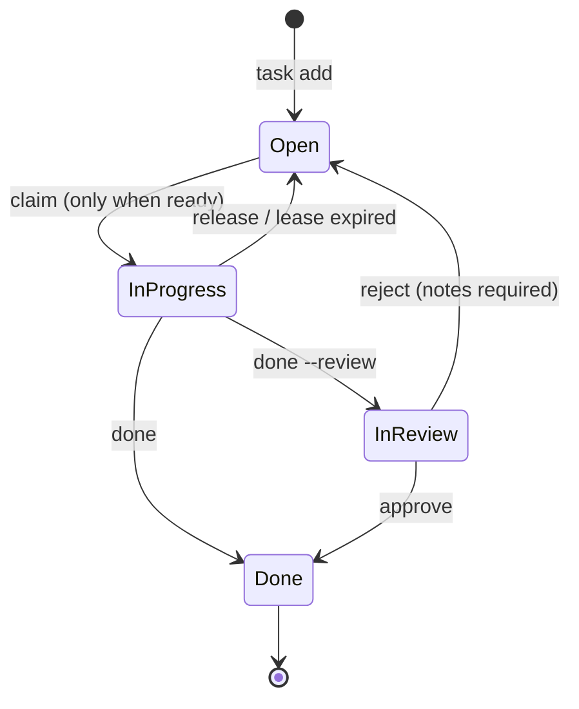

# Spec 01: Architecture & Data Model

## 1. Overview & Purpose

Airlock is a local-first CLI/MCP tool that manages tasks, questions, and session leases across concurrent human and AI agent sessions working on one project — typically spread over several git worktrees on one machine. It runs without a daemon: every invocation opens the shared store, does its work in a transaction, and exits.

Coordinating such work through a single hand-edited markdown file (like `PLAN.md`) causes friction:
1. **Merge conflicts**: concurrent branches editing the same plan document conflict on merge.
2. **Context blowup**: agent sessions parse an entire roadmap just to pick up one work package.
3. **Clean-room leaks**: implementation sessions can see material they must not see unless the material they receive is curated.

Airlock keeps live state in a store outside every repository and treats markdown documents as generated, regenerable exports (Spec 05).

---

## 2. Core Entities

The authoritative definitions are in `src/core.rs`; the shapes below mirror them.

### 2.1 Task (Work Package)

An atomic, self-contained unit of work, sized for a single agent session:

```rust
pub struct Task {
    pub id: String,                    // assigned on creation, e.g. "E-7", "L-12"; unique per project
    pub title: String,
    pub role: String,                  // must name a role from the project config
    pub state: TaskState,              // persisted: Open, InProgress, InReview, Done
    pub priority: i32,                 // higher first; default 0
    pub blocked_by: Vec<String>,       // prerequisite task ids
    pub read: Vec<String>,             // documentation / spec files to consult
    pub touch: Vec<String>,            // files the task may create or modify
    pub r#do: String,                  // concrete behavioral instructions
    pub verify: String,                // test command or scenario; never executed by Airlock
    pub notes: Option<String>,         // completion / review notes
    pub claimed_by: Option<String>,    // session holding the lease (InProgress only)
    pub lease_expires_at: Option<i64>, // unix seconds (InProgress only)
    pub created_at: i64,               // unix seconds
    pub updated_at: i64,               // unix seconds
}
```

`touch` is advisory: it tells the agent where to work and is shown to reviewers. Airlock does not enforce it.

#### Task Ids

Airlock assigns the id when a task is created; no interface accepts one. The id is `<prefix>-<n>`: the role's task prefix (Spec 06 §4; default: the role name's first letter or digit, upper-cased) and one more than the highest number used with that prefix among all tasks, done ones included. Ids that do not have the form `<prefix>-<digits>` (e.g. `E-6d` from before automatic numbering) are kept as they are and do not count. The number is chosen in the same write transaction as the insert, so concurrent creations never collide. Roles must not share a prefix: `role set` refuses such a change, and task creation fails while a hand-edited configuration has a clash. Ids never change; `task edit` cannot rename a task. Changing a role's prefix therefore starts a new sequence for its new tasks (`ENG-1`, `ENG-2`, …) while existing tasks keep their ids; switching back continues after the highest number used with the old prefix.

#### Persisted State vs. Effective Status

Only `TaskState` is stored. Whether an open task is blocked is **derived on every read** from its prerequisites, so it can never go stale:

| `TaskState` | Condition | Effective `TaskStatus` |
|---|---|---|
| `open` | some `blocked_by` task is not `done` | `blocked` |
| `open` | all `blocked_by` tasks are `done` (or none) | `ready` |
| `in_progress` | — | `in_progress` |
| `in_review` | — | `in_review` |
| `done` | — | `done` |

The inverse relation ("which tasks does this one unblock?") is likewise derived from other tasks' `blocked_by`, never stored.

#### Lifecycle



| Transition | CLI | MCP | Who |
|---|---|---|---|
| create | `task add` | `task_create` | any non-clean-room session |
| edit content | `task edit [--force]` | `task_update` | any non-clean-room session; tasks past `open` only with `--force` |
| claim | `task claim` | `task_claim` | any session; task must be `ready`, or `in_progress` with an expired lease |
| renew lease | `task heartbeat` | `task_heartbeat` | lease holder |
| release | `task release` | `task_release` | lease holder; others with `--force` |
| finish | `task done [--review]` | `task_complete` | lease holder; others with `--force` |
| approve | `task approve` | — | human / lead (CLI, dashboard) |
| reject | `task reject --notes` | — | human / lead (CLI, dashboard) |

Editing changes only the content fields (`title`, `role`, `priority`, `blocked_by`, `read`, `touch`, `do`, `verify`) and is not a transition: state, claim, lease, and `notes` stay as they are, and the id never changes. A task that is `in_progress`, `in_review`, or `done` is edited only with `--force`, since a session may be working from the old content.

Leaving `in_progress` always clears `claimed_by` and `lease_expires_at`. `done` is terminal; there is no reopen in v0.x — create a follow-up task instead.

#### Dependency Rules

- Every `blocked_by` id must name an existing task when the task is created. Tasks are therefore added in dependency order, which makes cycles impossible on `add`.
- Any operation that changes `blocked_by` on existing tasks (`task edit`, `airlock import`) must validate the whole graph: unique ids, known prerequisites, no cycles (`core::check_dependencies`).
- Completing a task needs no extra bookkeeping: dependents become `ready` by derivation. `task done` reports which dependents became ready as a result.

#### Selection Order for `task next`

Among tasks of the requested role with effective status `ready`: highest `priority` first, then oldest `created_at`, then `id` (byte order). The order is deterministic.

A ready task whose `touch` shares a path with an **occupying** task (`in_progress` or `in_review`; path rules in Spec 04 §3.5) is skipped in favor of the next task in this order. A task without `touch` data is never skipped, since its overlap is unknown. When every ready task overlaps, the first in order is returned anyway, together with its `overlaps`, so no session runs dry.

#### Overlap at Claim Time

An overlap never blocks a claim. Claiming a task that shares paths with occupying tasks succeeds, returns the `overlaps`, and records a question for the lead from the claiming session: topic `overlap:<task id>`, naming the shared paths, the occupying tasks, their status and holder, and asking whether to continue or release. While that session has an open question on the topic, claiming again reuses it unchanged, so its text describes the first claim. The question is recorded after the claim is committed: if recording it fails, the claim still succeeds and reports the overlaps with a `question_error` instead of a `question_id`. The session keeps working; the lead answers in the question channel or releases the task.

### 2.2 Question (Airlock Communication)

A structured behavioral inquiry across a session boundary, e.g. an engine session asking for clarification of a spec:

```rust
pub struct Question {
    pub id: u64,                    // assigned by the hub store, monotonically increasing
    pub topic: String,              // spec file or subsystem (e.g. "missiles.md")
    pub asked_by: String,           // session id of the asker
    pub question: String,
    pub status: QuestionStatus,     // Open, Answered, Resolved
    pub answer: Option<String>,     // behavioral prose only
    pub answered_by: Option<String>,
    pub spec_file: Option<String>,  // spec in which the answer was codified
    pub created_at: i64,
    pub answered_at: Option<i64>,
}
```

| Transition | CLI | MCP | Effect |
|---|---|---|---|
| ask | `question ask` | `question_ask` | new question, `open` |
| answer | `question answer [--spec]` | `question_answer` | `open`/`answered` → `answered`; revising an answer overwrites it and updates `answered_at` |
| resolve | `question resolve [--spec]` | `question_resolve` | `answered` → `resolved`; asker or any non-clean-room session |

### 2.3 Sessions

A session id is a free-form string naming one agent or human working context (e.g. `engine-1`, `human:peter`). Resolution order: `--session` flag, `AIRLOCK_SESSION` environment variable, then `human:$USER` for the CLI. The MCP server takes its session id from `--session`/`AIRLOCK_SESSION` or generates `mcp-<random>` at startup.

Session ids are **self-declared and not authenticated**. They identify cooperating sessions; they are not a security boundary (see Spec 05 §4).

### 2.4 Leases

- A claim grants a lease of `--lease` minutes (default: `lease_minutes` from the project config, 60).
- `task heartbeat` sets the lease to expire `--lease` minutes (default `lease_minutes`) from *now*.
- There is no daemon. Expiry is evaluated lazily: reads treat a task whose `lease_expires_at <= now` as expired, and every write transaction first resets expired leases to `open` (clearing `claimed_by`). A claim on an expired task therefore succeeds.

---

## 3. Storage Architecture

### 3.1 Hub Store

All live state lives in a per-project SQLite database outside every repository:

```
<hub>/projects/<project-uuid>/airlock.db     # tasks, questions (WAL mode)
<hub>/projects/<project-uuid>/project.json   # ProjectConfig (src/config.rs)
```

`<hub>` is `$AIRLOCK_HOME` if set, otherwise the platform state directory:

| Platform | Default `<hub>` |
|---|---|
| Linux | `$XDG_STATE_HOME/airlock` (`~/.local/state/airlock`) |
| macOS | `~/Library/Application Support/airlock` |
| Windows | `%LOCALAPPDATA%\airlock` |

The hub must be on a local filesystem: SQLite WAL does not work over network filesystems.

Projects reference their store through a committed marker file `.airlock` in the project root containing only `{"project_id": "<uuid>"}`. Because every worktree and clone carries the same marker, they all resolve the same store (Spec 05 §2).

### 3.2 Concurrency Rules

WAL mode allows many readers and one writer at a time. Correctness under concurrent sessions additionally requires:

- `PRAGMA journal_mode = WAL`, `PRAGMA foreign_keys = ON`, and a busy timeout (5 s) on every connection.
- Every mutation runs in a `BEGIN IMMEDIATE` transaction, so the write lock is taken before any read the decision depends on.
- Each write transaction first releases expired leases, then validates the transition against the current state (readiness, lease holder), then applies it as an update conditioned on the expected prior state (`… WHERE id = ? AND state = ?`). Zero affected rows is reported as an error, never retried silently. A losing concurrent claim sees the winner's lease and fails with `claimed by <session>`.
- Timestamps are unix seconds from the system clock, taken once per transaction.

### 3.3 Export Layer

`airlock sync` exports the store into a canonical JSON snapshot plus generated Markdown views inside the invoking project root. See Spec 05 §3.
