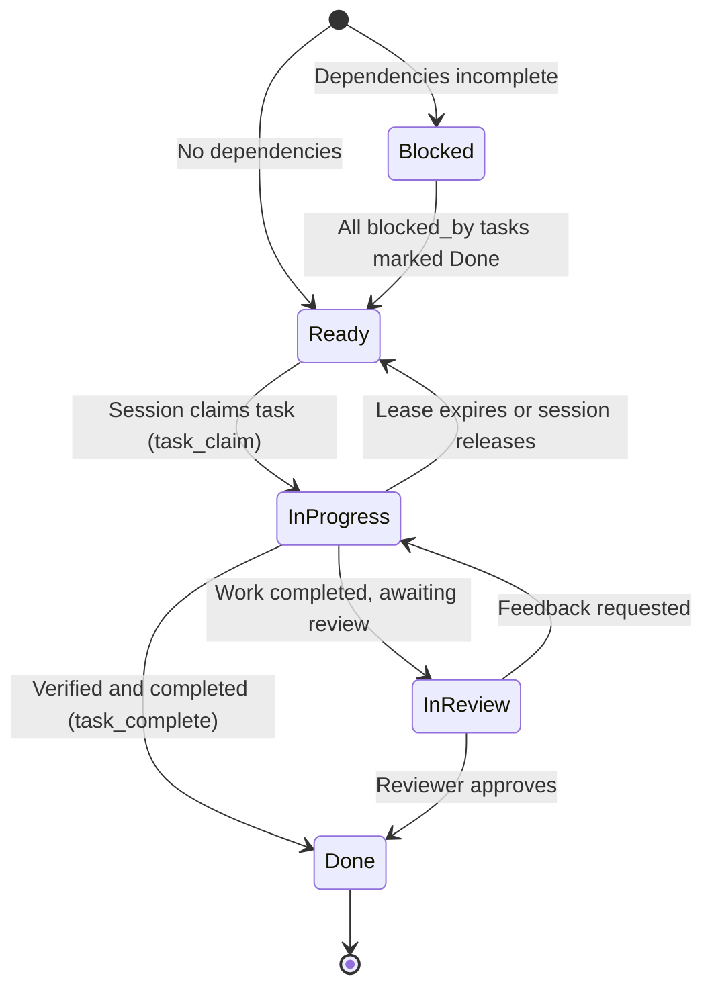

# Spec 01: Architecture & Data Model

## 1. Overview & Purpose

Airlock is a local-first coordination daemon and CLI/MCP tool that manages tasks, questions, and session leases across concurrent human and AI agent workflows.

In complex software projects with multiple development streams (e.g. Lead specification sessions, reverse engineering sessions, and clean-room engine implementation sessions), coordinating work through a single monolithic markdown file (like `PLAN.md`) causes severe friction:
1. **Merge Conflicts**: Concurrent branches editing the same plan document conflict upon merging.
2. **Context Blowup**: Agent sessions waste thousands of context tokens parsing an entire project roadmap just to pick up a single work package.
3. **Information Leaks across Clean-Room Boundaries**: Agents in clean-room environments risk seeing unauthorized implementation details or pseudocode unless strictly isolated.

Airlock solves this by decoupling live task state into an atomic store while keeping human-readable markdown documents as deterministically generated export artifacts.

---

## 2. Core Entities

### 2.1 Task (Work Package)

A `Task` represents an atomic, self-contained unit of work designed to be executable in a single agent session:

```rust
pub struct Task {
    pub id: String,                 // e.g. "E-6d", "L-12", "FEAT-42"
    pub title: String,              // Human-readable title
    pub role: String,               // Assigned role (e.g. "engine", "lead", "spec")
    pub status: TaskStatus,         // Blocked, Ready, InProgress, InReview, Done
    pub blocked_by: Vec<String>,    // IDs of tasks that must be Done
    pub unblocks: Vec<String>,      // IDs of tasks unblocked by this task
    pub read: Vec<String>,          // Documentation / spec files to consult
    pub touch: Vec<String>,         // Code / asset files allowed to be modified
    pub r#do: String,               // Concrete behavioral requirements
    pub verify: String,             // Exact test or command to prove completion
    pub notes: Option<String>,      // Completion notes or status summary
    pub claimed_by: Option<String>, // Session ID currently holding lease
    pub lease_expires_at: Option<i64>, // Unix timestamp for auto-release
    pub created_at: i64,
    pub updated_at: i64,
}
```

#### Task Status Lifecycle



### 2.2 Question (Airlock Communication)

A `Question` represents a structured behavioral inquiry across session boundaries (e.g. Engine session asking Lead session for specification clarification):

```rust
pub struct Question {
    pub id: u64,
    pub topic: String,              // Spec file or subsystem (e.g. "missiles.md")
    pub asked_by: String,           // Session ID or role of asker
    pub question: String,           // Detailed question text
    pub status: QuestionStatus,     // Open, Answered, Resolved
    pub answer: Option<String>,     // Answer text
    pub answered_by: Option<String>,// Session ID or human answering
    pub created_at: i64,
    pub answered_at: Option<i64>,
}
```

### 2.3 Session Lease & Heartbeat

To prevent duplicate work when multiple agent sessions run concurrently:
- When a session claims a task via CLI or MCP, a lease is granted with an expiry duration (default: 60 minutes).
- Active sessions can renew their lease via heartbeat.
- If a session terminates or crashes, the lease expires and the task automatically returns to `Ready`.

---

## 3. Storage Architecture

Airlock supports a dual-layer storage model:
1. **Local SQLite (`.airlock/airlock.db`)**:
   - Uses Write-Ahead Logging (WAL) mode.
   - Provides concurrent, multi-process read/write access across separate git worktrees without requiring a continuously running daemon.
   - Zero network overhead.
2. **Git-Synchronized Export Layer**:
   - CLI/MCP commands allow instant synchronization between the SQLite state and project markdown files (`docs/PLAN.md`, `docs/spec/QUESTIONS.md`).
