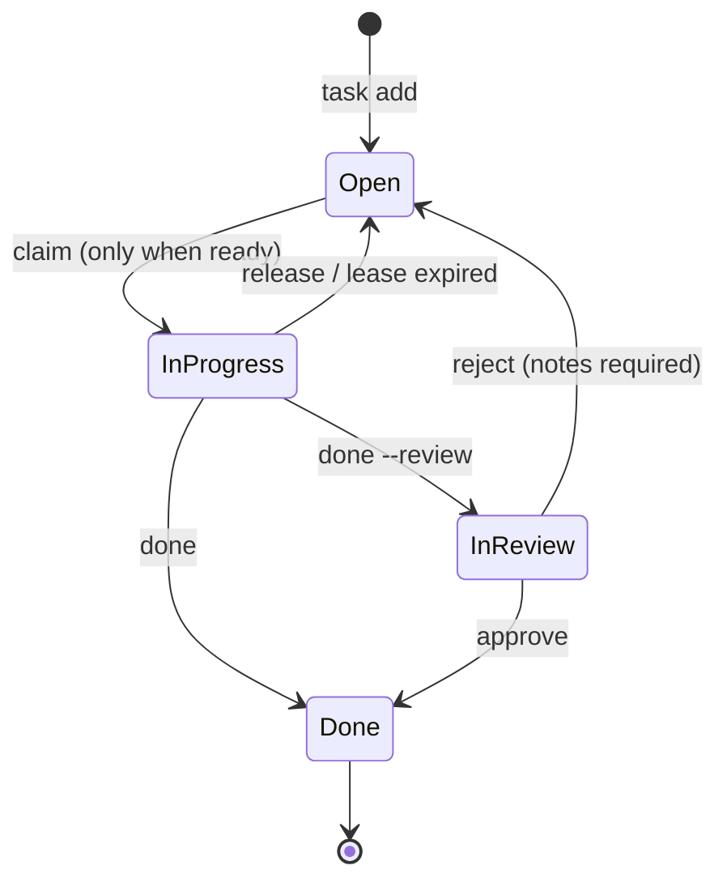

# Spec 01: Architecture & Data Model

## 1. Overview & Purpose

Airlock is a local-first CLI/MCP tool that manages tasks, questions, and session leases across concurrent human and AI agent sessions working on one project — typically spread over several git worktrees on one machine. It runs without a daemon: every invocation opens the shared store, does its work in a transaction, and exits.

Coordinating such work through a single hand-edited markdown file (like `PLAN.md`) causes friction:
1. **Merge conflicts**: concurrent branches editing the same plan document conflict on merge.
2. **Context blowup**: agent sessions parse an entire roadmap just to pick up one work package.
3. **Clean-room leaks**: implementation sessions can see material they must not see unless the material they receive is curated.

Airlock keeps live state in a store outside every repository and treats markdown documents as generated, regenerable exports (Spec 05).

---

## 2. Core Entities

The authoritative definitions are in `src/core.rs`; the shapes below mirror them.

### 2.1 Task (Work Package)

An atomic, self-contained unit of work, sized for a single agent session:

```rust
pub struct Task {
    pub id: String,                    // assigned on creation, e.g. "E-7", "L-12"; unique per project
    pub title: String,
    pub role: String,                  // must name a role from the project config
    pub state: TaskState,              // persisted: Open, InProgress, InReview, Done
    pub priority: Priority,            // Critical, High, Normal, Low; default Normal
    pub track: Option<String>,         // name of an existing track (§2.5); None = no track
    pub blocked_by: Vec<String>,       // prerequisite task ids
    pub read: Vec<String>,             // documentation / spec files to consult
    pub touch: Vec<String>,            // files the task may create or modify
    pub r#do: String,                  // concrete behavioral instructions
    pub verify: String,                // test command or scenario; never executed by Airlock
    pub notes: Option<String>,         // completion / review notes
    pub claimed_by: Option<String>,    // session holding the lease (InProgress only)
    pub lease_expires_at: Option<i64>, // unix seconds (InProgress only)
    pub created_at: i64,               // unix seconds
    pub updated_at: i64,               // unix seconds
}
```

`touch` is advisory: it tells the agent where to work and is shown to reviewers. Airlock does not enforce it.

#### Task Ids

Airlock assigns the id when a task is created; no interface accepts one. The id is `<prefix>-<n>`: the role's task prefix (Spec 06 §4; default: the role name's first letter or digit, upper-cased) and one more than the highest number used with that prefix among all tasks, done ones included. Ids that do not have the form `<prefix>-<digits>` (e.g. `E-6d` from before automatic numbering) are kept as they are and do not count. The number is chosen in the same write transaction as the insert, so concurrent creations never collide. Roles must not share a prefix: `role set` refuses such a change, and task creation fails while a hand-edited configuration has a clash. Ids never change; `task edit` cannot rename a task. Changing a role's prefix therefore starts a new sequence for its new tasks (`ENG-1`, `ENG-2`, …) while existing tasks keep their ids; switching back continues after the highest number used with the old prefix.

#### Persisted State vs. Effective Status

Only `TaskState` is stored. Whether an open task is blocked is **derived on every read** from its prerequisites, so it can never go stale:

| `TaskState` | Condition | Effective `TaskStatus` |
|---|---|---|
| `open` | some `blocked_by` task is not `done` | `blocked` |
| `open` | all `blocked_by` tasks are `done` (or none) | `ready` |
| `in_progress` | — | `in_progress` |
| `in_review` | — | `in_review` |
| `done` | — | `done` |

The inverse relation ("which tasks does this one unblock?") is likewise derived from other tasks' `blocked_by`, never stored.

#### Lifecycle



| Transition | CLI | MCP | Who |
|---|---|---|---|
| create | `task add` | `task_create` | any non-clean-room session |
| edit content | `task edit [--force]` | `task_update` | any non-clean-room session; tasks past `open` only with `--force` |
| claim | `task claim` | `task_claim` | any session; task must be `ready`, or `in_progress` with an expired lease |
| renew lease | `task heartbeat` | `task_heartbeat` | lease holder |
| release | `task release` | `task_release` | lease holder; others with `--force` |
| finish | `task done [--review]` | `task_complete` | lease holder; others with `--force` |
| approve | `task approve` | — | human / lead (CLI, dashboard) |
| reject | `task reject --notes` | — | human / lead (CLI, dashboard) |

Editing changes only the content fields (`title`, `role`, `priority`, `track`, `blocked_by`, `read`, `touch`, `do`, `verify`) and is not a transition: state, claim, lease, and `notes` stay as they are, and the id never changes. A task that is `in_progress`, `in_review`, or `done` is edited only with `--force`, since a session may be working from the old content.

Leaving `in_progress` always clears `claimed_by` and `lease_expires_at`. `done` is terminal; there is no reopen in v0.x — create a follow-up task instead.

#### Dependency Rules

- Every `blocked_by` id must name an existing task when the task is created. Tasks are therefore added in dependency order, which makes cycles impossible on `add`.
- Any operation that changes `blocked_by` on existing tasks (`task edit`, `airlock import`) must validate the whole graph: unique ids, known prerequisites, no cycles (`core::check_dependencies`).
- Completing a task needs no extra bookkeeping: dependents become `ready` by derivation. `task done` reports which dependents became ready as a result.

#### Selection Order for `task next`

Among tasks of the requested role with effective status `ready`:

1. highest **track priority** first (a task without a track, or with a track that is unknown, counts as `normal`),
2. then highest task `priority`,
3. then oldest `created_at`,
4. then `id` (byte order).

The order is deterministic.

A ready task whose `touch` shares a path with an **occupying** task (`in_progress` or `in_review`; path rules in Spec 04 §3.5) is skipped in favor of the next task in this order. A task without `touch` data is never skipped, since its overlap is unknown. When every ready task overlaps, the first in order is returned anyway, together with its `overlaps`, so no session runs dry.

#### Overlap at Claim Time

An overlap never blocks a claim. Claiming a task that shares paths with occupying tasks succeeds, returns the `overlaps`, and records a question for the lead from the claiming session: topic `overlap:<task id>`, naming the shared paths, the occupying tasks, their status and holder, and asking whether to continue or release. While that session has an open question on the topic, claiming again reuses it unchanged, so its text describes the first claim. The question is recorded after the claim is committed: if recording it fails, the claim still succeeds and reports the overlaps with a `question_error` instead of a `question_id`. The session keeps working; the lead answers in the question channel or releases the task.

### 2.2 Question (Airlock Communication)

A structured behavioral inquiry across a session boundary, e.g. an engine session asking for clarification of a spec:

```rust
pub struct Question {
    pub id: u64,                    // assigned by the hub store, monotonically increasing
    pub topic: String,              // spec file or subsystem (e.g. "missiles.md")
    pub asked_by: String,           // session id of the asker
    pub question: String,
    pub status: QuestionStatus,     // Open, Answered, Resolved
    pub answer: Option<String>,     // behavioral prose only
    pub answered_by: Option<String>,
    pub spec_file: Option<String>,  // spec in which the answer was codified
    pub created_at: i64,
    pub answered_at: Option<i64>,   // time of the current answer
    pub corrected_at: Option<i64>,  // time of the latest correction; None if never corrected
    pub corrected_by: Option<String>, // session that made it
    pub history: Vec<AnswerVersion>, // answers replaced by corrections, oldest first
}

pub struct AnswerVersion {
    pub answer: String,
    pub answered_by: Option<String>,
    pub answered_at: Option<i64>,
    pub spec_file: Option<String>,  // spec file recorded with that answer
}
```

| Transition | CLI | MCP | Effect |
|---|---|---|---|
| ask | `question ask` | `question_ask` | new question, `open` |
| answer | `question answer [--spec]` | `question_answer` | `open` → `answered`. On a question that already has an answer (`answered` or `resolved`) this is a correction: the status stays, the new answer replaces the current one, the replaced answer moves to the question's history (oldest first), and `corrected_at`/`corrected_by` are set |
| resolve | `question resolve [--spec]` | `question_resolve` | `answered` → `resolved`; asker or any non-clean-room session |

**Corrections.** An answer can be corrected for as long as the question exists, also after it was resolved: the only requirement is that the question already has an answer. A correction is allowed for whoever may answer (clean-room sessions cannot, Spec 03 §2.1). It keeps the status (a resolved question stays resolved), replaces `answer`, `answered_by`, and `answered_at` with the new values, and sets `corrected_at` and `corrected_by` to the same time and session. A given `spec_file` replaces the recorded one; an absent one keeps it. The replaced answer is appended to `history` with its author, time, and spec file, so every earlier answer stays retrievable; `history` is oldest first, and each further correction appends one entry. A question that was never corrected has no `corrected_at`, `corrected_by`, or `history`. The correction reaches the asking session through its next briefing (Spec 06 §3.1); it is also an activity problem (§3.7) and appears in `QUESTIONS.md` (Spec 05 §3.3).

### 2.3 Sessions

A session id is a free-form string naming one agent or human working context (e.g. `engine-1`, `human:peter`). Resolution order: `--session` flag, `AIRLOCK_SESSION` environment variable, then `human:$USER` for the CLI. The MCP server takes its session id from `--session`/`AIRLOCK_SESSION` or generates `mcp-<random>` at startup.

Session ids are **self-declared and not authenticated**. They identify cooperating sessions; they are not a security boundary (see Spec 05 §4).

### 2.4 Leases

- A claim grants a lease of `--lease` minutes (default: `lease_minutes` from the project config, 60).
- `task heartbeat` sets the lease to expire `--lease` minutes (default `lease_minutes`) from *now*.
- There is no daemon. Expiry is evaluated lazily: reads treat a task whose `lease_expires_at <= now` as expired, and every write transaction first resets expired leases to `open` (clearing `claimed_by`). A claim on an expired task therefore succeeds.

### 2.5 Priority and Track

**Priority** is one fixed scale for tasks and tracks, serialized in lowercase on every surface (CLI, MCP, REST, snapshot):

| Level | Meaning |
|---|---|
| `critical` | handed out before everything else |
| `high` | handed out before normal work |
| `normal` | the default for new tasks and tracks |
| `low` | handed out last |

Levels are ordered `critical` > `high` > `normal` > `low`. No interface accepts a number; a number given as priority is an error that lists the four levels. Internally the store keeps the rank (`low` 0 … `critical` 3) in an `INTEGER` column; nothing outside the store sees it.

**Track:** a named line of work with its own priority, created on the fly by the lead (CLI or MCP). Tracks span roles: a task belongs to at most one track, and tasks without a track stay valid.

```rust
pub struct Track {
    pub name: String,         // primary key; letters, digits, `-`, `_`; case preserved, unique exactly
    pub priority: Priority,   // default Normal
    pub description: String,  // free text, may be empty
    pub created_at: i64,      // unix seconds
    pub updated_at: i64,      // unix seconds
}
```

| Operation | CLI | MCP | Who |
|---|---|---|---|
| list | `track list` | `track_list` | any session on the CLI; not in the clean-room MCP set (Spec 03 §2.1) |
| create | `track add` | `track_create` | any session; clean-room MCP sessions cannot |
| change | `track edit` | `track_update` | any session; clean-room MCP sessions cannot |
| remove | `track remove` | `track_remove` | any session; clean-room MCP sessions cannot |

- `list` is sorted by priority (highest first), then name, and carries per track the number of its tasks per effective status (`blocked`, `ready`, `in_progress`, `in_review`, `done`).
- `create` fails on an existing or invalid name.
- `change` can rename; the rename updates every task referencing the track in the same transaction and leaves the tasks' `updated_at` untouched.
- `remove` is refused while any task, in any state, uses the track.
- A task names an existing track on `task add` / `task_create` and on edit; an unknown track is an error that names the defined tracks. Editing the track of a task that is `in_progress`, `in_review`, or `done` needs `--force` like every content edit (§2.1).

---

## 3. Storage Architecture

### 3.1 Hub Store

All live state lives in a per-project SQLite database outside every repository:

```
<hub>/projects/<project-uuid>/airlock.db     # tasks, tracks, questions (WAL mode)
<hub>/projects/<project-uuid>/activity.db    # activity log and process registry (WAL mode, §3.5)
<hub>/projects/<project-uuid>/project.json   # ProjectConfig (src/config.rs)
```

`<hub>` is `$AIRLOCK_HOME` if set, otherwise the platform state directory:

| Platform | Default `<hub>` |
|---|---|
| Linux | `$XDG_STATE_HOME/airlock` (`~/.local/state/airlock`) |
| macOS | `~/Library/Application Support/airlock` |
| Windows | `%LOCALAPPDATA%\airlock` |

The hub must be on a local filesystem: SQLite WAL does not work over network filesystems.

Projects reference their store through a committed marker file `.airlock` in the project root containing only `{"project_id": "<uuid>"}`. Because every worktree and clone carries the same marker, they all resolve the same store (Spec 05 §2).

### 3.2 Concurrency Rules

WAL mode allows many readers and one writer at a time. Correctness under concurrent sessions additionally requires:

- `PRAGMA journal_mode = WAL`, `PRAGMA foreign_keys = ON`, and a busy timeout (5 s) on every connection.
- Every mutation runs in a `BEGIN IMMEDIATE` transaction, so the write lock is taken before any read the decision depends on.
- Each write transaction first releases expired leases, then validates the transition against the current state (readiness, lease holder), then applies it as an update conditioned on the expected prior state (`… WHERE id = ? AND state = ?`). Zero affected rows is reported as an error, never retried silently. A losing concurrent claim sees the winner's lease and fails with `claimed by <session>`.
- Timestamps are unix seconds from the system clock, taken once per transaction.

### 3.3 Export Layer

`airlock sync` exports the store into a canonical JSON snapshot plus generated Markdown views inside the invoking project root. See Spec 05 §3.

### 3.4 Schema Migration

The store carries a schema version and upgrades older databases in place on first open. Version 5 adds answer corrections (§2.2): the nullable columns `questions.corrected_at` and `questions.corrected_by`, and the table `answer_history` (one row per replaced answer, numbered per question). Existing questions are unchanged. A trigger on `questions` refuses to replace an answer unless the newest `answer_history` row of that question holds it, which the correction path always writes first. As with every migration, an older airlock binary refuses a store at a newer version when it opens it; an older process that opened the store before the upgrade keeps running, and the trigger stops it from overwriting an answer without history: its answer fails with "restart old airlock processes". Restart `airlock mcp` and `airlock serve` processes after upgrading. The activity log (§3.5) is a separate database with its own schema version; older binaries do not know it and ignore it.

Version 4 adds tracks and the priority scale:

- creates the `tracks` table and the nullable `tasks.track` column;
- converts the integer priorities of existing tasks in place: `>= 30` becomes `high`, `10..=29` becomes `normal`, `< 10` (negatives included) becomes `low`. Nothing becomes `critical`: that stays a deliberate choice;
- assigns no track; the lead assigns existing tasks afterwards;
- adds triggers on `tasks` that refuse a priority outside the ranks 0 to 3, on insert and on update. An airlock process from before the upgrade that is still running would otherwise write integer priorities the new version cannot read; its writes now fail with "restart old airlock processes" instead. Restart `airlock mcp` and `airlock serve` processes after upgrading.

### 3.5 Activity Log

Every operation that passes through Airlock leaves one entry in the **activity log**, so the user can see who did what, where, and what went wrong. The log lives in `activity.db`, next to `airlock.db` in the project's hub directory: a separate SQLite file (WAL mode, own schema version, same 5 s busy timeout) so that logging never contends with task state and older binaries, which do not know the file, keep working. The implementation is `src/activity.rs`.

One entry per operation:

| Field | Meaning |
|---|---|
| `id` | assigned by the log, increasing |
| `at` | unix seconds |
| `session` | the acting session id |
| `role` | the bound or given role, if any |
| `clean_room` | whether that role is clean-room |
| `channel` | `mcp`, `cli`, or `rest` |
| `agent` | the agent behind the call, if recognised (below) |
| `command` | MCP: the tool name (`task_claim`), plus `prompt start` for the `start` prompt; CLI: the subcommand path (`task edit`, `question answer`); REST: `<METHOD> <route pattern>` (`POST /api/questions/{id}/answer`, every `GET` is logged as `GET <route>`) |
| `target` | task id, question id (`#15`), track name, or role name, if the operation has one |
| `changed` | for writes: a list of the argument names given, e.g. `track`, `priority: high`, `blocked_by`; `correction` is added to a successful answer that corrected an earlier one |
| `write` | whether the command changes state: false for the reads (`session_start`, `prompt start`, `task_next`, `task_get`, `question_list`, `track_list`, `start`, `task list`, `task next`, `task show`, `track list`, `question list`, `role list`, a `use` that only shows the binding, and every REST `GET`) |
| `ok` | success or failure |
| `error` | on failure, the error message |
| `pid`, `build` | process id and build identity (§3.6) of the caller |

**No free text.** The log never stores `do`, `verify`, notes, question or answer text, descriptions, or titles; these can carry material from the analysis side of a clean-room project. `changed` holds argument names only. The values of `priority`, `track`, `role`, `status`, `review`, `lease_minutes`, `clean_room`, and `lock` are attached as `name: value`, and only when the value is a plain word of at most 40 characters (letters, digits, `-`, `_`, `.`); any other value, in these or other arguments, is reduced to the name. A rename (`new_name`) is recorded as `name`. `target` and each argument name are cut to 120 characters, so even a hostile value in an identifying argument cannot fill the log. `error` is the message verbatim, cut to 300 characters; Airlock's messages name ids, roles, tracks, fields, and allowed values, not text bodies.

**What is logged.** Every call once the project is resolved, reads and failures included: an MCP call to a tool hidden from a clean-room role, an unknown tool, invalid arguments, a CLI error after argument parsing, and a REST call that fails inside a handler (the error is the response's message). Not logged:

- CLI: `init`, `doctor`, `mcp`, `serve`, `setup`, and `activity` itself. `mcp` and `serve` register as processes instead (§3.6). `use` is logged under the session it binds.
- REST: `/api/events`, the `/api/activity*` endpoints, every `GET` carrying the header `X-Airlock-Client: dashboard` (the dashboard's own polling), requests rejected by the guards of Spec 04 §2 (token, Host, Origin, content type), and requests to paths no route handles (404).
- Anything before a project is known: usage errors, no marker, malformed JSON-RPC.

No MCP tool exposes the log.

**Identity.** MCP entries carry the session and role of the server, and `agent` from the client's `clientInfo.name` in `initialize`. CLI entries carry the resolved session (Spec 02 §2.1) and the binding's role (or `--role` for `start` and `task next`). REST has no role binding: entries carry no role and are never clean-room; the session is `dashboard` for requests with `X-Airlock-Client: dashboard` (the dashboard's answers and releases) and `rest` for every other caller. A CLI call inherits its session from the worktree binding, so an agent and the user in the same directory look alike; `agent` tells them apart. It is taken from the environment of the CLI process: `AI_AGENT` (the text before its first `_`, e.g. `claude-code` from `claude-code_2.1`), else `CLAUDECODE=1` (`claude-code`). A harness that sets neither shows as a plain CLI call.

**Retention and failure.** Entries older than 30 days are deleted in the transaction that writes the next entry; there is no timer. A failure to open or write the log never fails the operation: the CLI, the MCP server, and the dashboard print `airlock: activity log: <error>` to stderr and carry on. The log is created on the first entry; reading a missing log yields nothing.

### 3.6 Process Registry and Build Identity

A second table of `activity.db` registers the long-running processes. `airlock mcp` and `airlock serve` register on start (kind `mcp` or `serve`, pid, build identity, session, role, start time), refresh a `last_seen` stamp every 60 seconds, and remove their row on a clean exit. A process counts as **live** while its `last_seen` is at most 180 seconds old; stale rows are deleted when the registry is read. There is no pid probing, so the check is portable. A process that cannot register (log unusable, no project resolved) runs unregistered after printing the usual `airlock: activity log: …` line. Processes started before the registry existed never register.

The **build identity** is `<package version>+<unix build time>`, stamped into the binary at compile time as `AIRLOCK_BUILD` (`build.rs`), e.g. `0.1.0+1793580000`. Every build of the same package version differs by its build time, which is what is compared. Entries record the identity of their caller in `build`.

### 3.7 Problems

Problems are computed from the log and the registry on every read, never stored, and cannot be acknowledged or dismissed: they leave when the entries behind them leave the 30-day window (or, for `old_process`, when the process ends). Each problem has a kind, a message, the session and role where there is one, a `count`, `first_at`/`last_at`, and the ids of the entries behind it.

| Kind | Fires when | Grouping |
|---|---|---|
| `failure` | an entry with `ok = false`; the message is the latest error | one problem per session and command, with count |
| `clean_room_cli` | an entry on channel `cli` by a clean-room role for a command the clean-room MCP set does not offer: `task add`, `task edit`, `task approve`, `task reject`, `track add`, `track edit`, `track remove`, `question answer`, `question resolve`, `sync`, `import`, `role set`, `role remove`, `use`. Reads (including a `use` that only shows the binding) and the commands the clean-room set has (`task claim`, `task heartbeat`, `task release`, `task done`, `question ask`) are not flagged. Failed attempts count. Every command but `use` fires whether or not `agent` is recognised, so an unknown harness cannot keep the problem list calm; `use` fires only when `agent` is recognised, because binding a worktree from the user's own shell is a setup step | one problem per session, listing the commands |
| `error_burst` | five or more failures of one session within 600 seconds | one problem per run of overlapping windows |
| `answer_corrected` | a successful answer whose `changed` contains `correction` (§2.2) | one problem per session and question |
| `old_process` | a live registered process whose build time is older than the newest known: the newest of the live registered processes and the process doing the check (CLI, `serve`) | one problem per process |

`failure` and `error_burst` overlap on purpose: the first names the command, the second says the session is in trouble. The terminal (`airlock activity --problems`, Spec 02 §3.7) and the dashboard (Spec 04 §3.11) show the same list.
