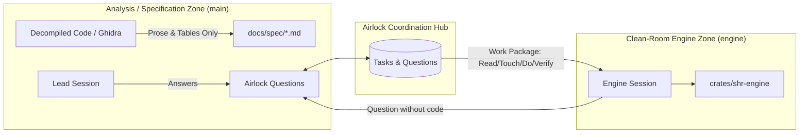

# Spec 05: Git Sync & Airlock Boundary

## 1. Overview & Clean-Room Principles

In reverse engineering and clean-room reimplementation projects (such as OpenSHR), legal and architectural boundaries dictate that implementation code must not be tainted by direct inspection of disassembled or decompiled artifacts.

Knowledge crosses only through behavioral specifications.

---

## 2. Zero-Conflict Git Integration

### 2.1 The Multi-Worktree Problem
When work is divided across multiple worktrees (e.g. `~/Projects/openshr` on `main` and `~/Projects/openshr-engine` on `engine`):
- Modifying a central markdown file (`PLAN.md` or `QUESTIONS.md`) on both branches causes continuous git merge conflicts.
- Coordinating via git commits requires unnecessary intermediate commits just to communicate questions or task handoffs.
- A database file placed in the repository's working root is **not** shared either: each git worktree owns an independent copy of the working tree, so a repo-local `airlock.db` would silently fork the task store per worktree.

### 2.2 The Airlock Hub Solution
1. **Central Hub Store (single source of truth)**:
   All task and question state lives in an Airlock-owned SQLite database, independent of any repository:
   `~/.local/state/airlock/projects/<uuid>/airlock.db` (SQLite, WAL mode), alongside a hub-side `project.json` holding project configuration and the single registered project path. WAL permits concurrent readers and writers from every session on the same machine; the store is never placed inside a repository (see 2.1).
2. **Project Marker File**:
   `airlock init` writes a merge-trivial marker file `.airlock` containing only the project id (`{"project_id": "<uuid>"}`) into the project directory. Commands resolve their project by precedence: `--project <id-or-name>` flag, `AIRLOCK_PROJECT` environment variable, then the nearest `.airlock` marker found by searching upward from the current working directory. Commands outside a registered project fail with a clear error; Airlock never inspects git internals to locate state.
3. **Deterministic Export (`airlock sync`)**:
   When milestone or release commits are prepared, `airlock sync` compiles the current task and question state into all export artifacts (see Section 3). This preserves git history and human readability without subjecting day-to-day parallel work to merge conflicts.

---

## 3. Export & Import Layer

The hub database is the **single source of truth** for live state. Exported files are regenerable artifacts committed to the repository for human review, audit, and disaster recovery.

### 3.1 Export Artifacts
One `airlock sync` run writes all artifacts into the project's registered path:

| Artifact | Role |
|---|---|
| `docs/.airlock-state.json` | **Canonical** state snapshot: lossless backup and the only source for `airlock import`. |
| `docs/PLAN.md` | Generated human-readable plan view. |
| `docs/spec/QUESTIONS.md` | Generated question/answer log (clean-room audit trail). |

Paths are configurable via the project configuration (`ExportConfig`, including a `state_file` for the snapshot path).

### 3.2 Snapshot Content
The snapshot captures the semantic project state. **Ephemeral runtime fields are excluded**: lease expiry and session claims describe runtime sessions, not project state, and are meaningless once a session ends. On `airlock import`, `claimed_by` is restored as `None`; tasks left `InProgress` become orphaned leases recoverable via `task release`.

**Task:**

| Field | Type | Exported |
|---|---|---|
| `id` | string | yes |
| `title` | string | yes |
| `role` | string | yes |
| `status` | `blocked \| ready \| in_progress \| in_review \| done` | yes |
| `blocked_by` | string[] | yes |
| `unblocks` | — | no: derived from other tasks' `blocked_by` |
| `read` | string[] | yes |
| `touch` | string[] | yes |
| `do` | string | yes |
| `verify` | string | yes |
| `notes` | string \| null | yes |
| `claimed_by`, `lease_expires_at` | — | no: ephemeral session state |

**Question** (all fields exported):

| Field | Type |
|---|---|
| `id` | number |
| `topic` | string |
| `asked_by` | string |
| `question` | string |
| `status` | `open \| answered \| resolved` |
| `answer` | string \| null |
| `answered_by` | string \| null |

### 3.3 Deterministic Serialization
Byte-stable output is mandatory: re-running `airlock sync` on unchanged state must produce a zero diff.
- Object fields serialize in fixed declaration order (serde struct order); maps are sorted by key (`BTreeMap`, not `HashMap`).
- Arrays are sorted by `id` (tasks and questions).
- Enums serialize snake_case (matching the domain model's `#[serde(rename_all = "snake_case")]`).
- UTF-8, LF line endings, 2-space indent, exactly one trailing newline.

### 3.4 Import (`airlock import`)
- The JSON snapshot is the **only** canonical import source. Markdown files are views and are never parsed to reconstruct state.
- Import replaces the project's task and question state with the snapshot content and requires explicit confirmation (`--yes` or interactive prompt).
- Leases are not restored (see 3.2).

### 3.5 Merge Strategy: Regenerate, Don't Resolve
If concurrent branches both run `airlock sync`, the generated files (`PLAN.md`, `QUESTIONS.md`, `.airlock-state.json`) may conflict textually on merge. Resolution rule:
1. Complete the git merge, taking either side for generated files.
2. Run `airlock sync` again.

Because the hub database is outside git, it always holds the authoritative state — regenerated artifacts are correct by construction. **Never hand-edit or hand-resolve generated files.**

---

## 4. Role of the Markdown Views
- `PLAN.md` and `QUESTIONS.md` are generated views for human review (GitHub rendering, PR discussions), agent orientation, and the clean-room audit trail: `QUESTIONS.md` documents which behavioral prose crossed the airlock boundary (topic, asker, question, answer) — a compliance-relevant record.
- They are regenerable at any time and must never be treated as a state source.

## 5. Legacy Migration
Importing pre-existing monolithic `PLAN.md` files (e.g. OpenSHR `L-...` / `E-...` packages) is a one-time migration tool (`airlock import-plan`), not part of the canonical round-trip. Lossless Markdown parsing is explicitly **not** a goal; the canonical exchange format is the JSON snapshot only.
