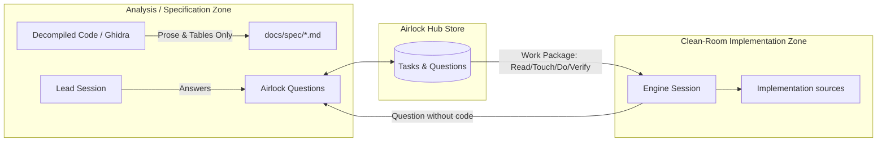

# Spec 05: Git Sync & Airlock Boundary

## 1. Overview & Clean-Room Principles

In clean-room reimplementation projects, implementation code must not be derived from direct inspection of disassembled or decompiled artifacts. Knowledge crosses from the analysis side to the implementation side only as behavioral specifications and prose answers.



Airlock structures this exchange and records it (§4). It does not by itself prevent a session from reading files it has access to — see §4.2.

---

## 2. Zero-Conflict Git Integration

### 2.1 The Multi-Worktree Problem
When work is split across worktrees (e.g. `~/Projects/game` on `main` and `~/Projects/game-engine` on `engine`):
- Editing a central markdown file (`PLAN.md`, `QUESTIONS.md`) on both branches causes recurring merge conflicts.
- Communicating questions or handoffs through commits requires throwaway commits.
- A database inside the repository is **not** shared: each worktree owns its own working-tree copy, so a repo-local database would silently fork the task store per worktree.

### 2.2 Hub Store and Marker
1. **Hub store (single source of truth):** all task and question state lives in the per-project SQLite database in the hub, outside every repository (Spec 01 §3.1). Every session on the machine reads and writes the same database.
2. **Marker:** `airlock init` writes `.airlock` (`{"project_id": "<uuid>"}`) into the project root. It is committed, so every worktree and clone carries it, and it never changes after creation — it cannot conflict. Because the marker is repository content, its id is untrusted input: Airlock accepts only a canonical lowercase hyphenated UUID and rejects anything else before building hub paths from it.
3. **No registered path:** the hub does not record where the project lives. Each invocation's project root is the directory of the marker it found (Spec 02 §2.2), so `airlock sync` in a worktree writes into *that* worktree.

### 2.3 Bootstrap on Another Machine
Cloning a repository brings the marker but not the hub state. `airlock init` in the clone creates a hub project with the marker's id; `airlock import` then loads the committed snapshot. From then on the two machines have **independent** hubs (§2.4).

### 2.4 Scope: One Machine per Project State
The hub is local. v0.x supports any number of sessions and worktrees **on one machine**. Several machines working on the same project each have their own hub; Airlock does not merge their states. Committed snapshots carry state between machines only as a deliberate handover (`sync` on one machine, `import` on the other). Multi-machine synchronization is a separate future design (ROADMAP milestone 4). §3.5 makes sure that one machine's `sync` cannot silently overwrite state committed by another.

---

## 3. Export & Import Layer

The hub database is the single source of truth for live state. Exported files are regenerable artifacts committed for human review, audit, and handover.

### 3.1 Export Artifacts
One `airlock sync` run writes, relative to the invoking project root (paths configurable in `ExportConfig`; they must be relative, must not leave the root, and must be distinct — compared case-insensitively — so no view can overwrite the snapshot):

| Artifact | Default path | Role |
|---|---|---|
| State snapshot | `docs/.airlock-state.json` | **Canonical**: lossless semantic state; the only `airlock import` source |
| Plan view | `docs/PLAN.md` | Generated human-readable plan (optional) |
| Question log | `docs/spec/QUESTIONS.md` | Generated question/answer log — the clean-room audit trail (optional) |

### 3.2 Snapshot Content
The snapshot (`src/snapshot.rs`) contains semantic project state only. **Session state is excluded**, so claiming, renewing, or releasing a task never changes the file:

```json
{
  "format_version": 1,
  "project_id": "<uuid>",
  "roles": { "<name>": { "description": "...", "clean_room": false } },
  "tasks": [ … ],
  "questions": [ … ]
}
```

**Task records:**

| Field | Type | Notes |
|---|---|---|
| `id`, `title`, `role` | string | |
| `state` | `open \| in_review \| done` | `in_progress` exports as `open` — a claim is session state |
| `priority` | integer | |
| `blocked_by` | string[] | sorted, deduplicated |
| `read`, `touch` | string[] | order preserved (authored order is meaningful) |
| `do`, `verify` | string | |
| `notes` | string \| null | |
| `created_at` | integer | unix seconds |
| `claimed_by`, `lease_expires_at`, `updated_at` | — | not exported: session state / write noise |

**Questions** are exported with all fields (Spec 01 §2.2).

### 3.3 Deterministic Serialization
Re-running `airlock sync` on unchanged state must produce a zero diff:
- Object fields in fixed declaration order; maps sorted by key (`BTreeMap`).
- `tasks` sorted by `id` (byte order), `questions` by `id`.
- Enums in `snake_case`.
- UTF-8, LF line endings, 2-space indent, exactly one trailing newline.

`tests/snapshot.rs` pins the exact bytes with a golden file; any change to it is a format change and requires bumping `format_version`.

The Markdown views (`src/views.rs`) are rendered from the snapshot itself, not from live state, so they follow the same rules: sorted, no timestamps, and unchanged by claims (a claimed task appears as ready). Files whose content is unchanged are not rewritten; changed files are written atomically (temp file, `fsync`, rename). Single-line fields (ids, titles, roles, topics, session ids) have their whitespace collapsed in headings and table cells, so input with newlines cannot break the document structure.

### 3.4 Import (`airlock import`)
- The JSON snapshot is the only import source. Markdown files are views and are never parsed to reconstruct state.
- Before writing, import checks: `format_version` is supported, `project_id` matches the resolved project, roles referenced by tasks exist, and the dependency graph is valid (unique ids, known prerequisites, no cycles).
- Import replaces tasks and questions and records the snapshot's hash as known in one transaction, then writes the roles to `project.json`. If that last write fails, the data is already imported; re-running the import completes it. Import requires confirmation (`--yes` or interactive prompt). Question ids are kept; new questions continue after the highest id this hub ever used or imported, so ids are never reused.
- Since snapshots contain no claims, all imported tasks are unclaimed.

### 3.5 Foreign-Change Guard
The hub stores the SHA-256 of every snapshot it has written or imported. Before overwriting an existing snapshot file, `sync` checks it:

| Existing file | Action |
|---|---|
| absent, or identical to the new output | write (no-op if identical) |
| hash known to this hub | overwrite — the content came from this hub's own history |
| hash unknown | **refuse**: the file came from elsewhere (another machine, hand edit). Inspect it, then either `airlock import` to adopt it or `airlock sync --force` to replace it |

A file containing git conflict markers is never a known hash and is handled by the merge rule below.

### 3.6 Merge Rule: Regenerate, Don't Resolve
If two branches both ran `airlock sync`, the generated files may conflict on merge. On one machine:
1. Complete the merge, taking either side of each generated file.
2. Run `airlock sync`.

Either side was written by this hub, so §3.5 lets `sync` overwrite it with the current state. If `sync` refuses, the file came from another machine's hub — decide explicitly with `import` or `sync --force` (§2.4). **Never hand-edit generated files.**

---

## 4. The Airlock Boundary

### 4.1 What Airlock Provides
- **Curated work packages:** clean-room sessions receive *Read/Touch/Do/Verify* packages that point only at committed behavioral specs.
- **A structured question channel:** questions and prose answers, with asker, answerer, timestamps, and the spec file that codified the answer.
- **An audit trail:** `QUESTIONS.md` records what crossed the boundary, in git history.
- **Role-bound tool sets:** MCP servers bound to a clean-room role expose a restricted tool set (Spec 03 §2.1).

### 4.2 What Airlock Does Not Provide
Session ids and roles are self-declared, and every process running as the same OS user can read the hub database and run any CLI command. Airlock's restrictions prevent **accidents** by cooperating agents; they do not stop a session that deliberately bypasses them. Real isolation of a clean-room session — no access to decompiled sources, analysis worktrees, or the unrestricted CLI — must come from the environment: a separate OS user, container, or sandbox that sees only the implementation worktree and an Airlock MCP server bound to the clean-room role.

Answers are prose written by people or lead sessions; Airlock does not inspect them for code. Keeping answers free of implementation details is the answering party's responsibility, made reviewable by the audit trail.

---

## 5. Legacy Migration
Importing a pre-existing hand-written `PLAN.md` (e.g. `L-…` / `E-…` work packages) is a one-time migration tool (`airlock import-plan`), not part of the canonical round-trip. Lossless Markdown parsing is explicitly not a goal.
