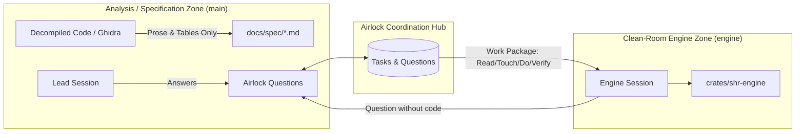

# Spec 05: Git Sync & Airlock Boundary

## 1. Overview & Clean-Room Principles

In reverse engineering and clean-room reimplementation projects (such as OpenSHR), legal and architectural boundaries dictate that implementation code must not be tainted by direct inspection of disassembled or decompiled artifacts.

Knowledge crosses only through behavioral specifications.

---

## 2. Zero-Conflict Git Integration

### 2.1 The Multi-Worktree Problem
When work is divided across multiple worktrees (e.g. `~/Projects/openshr` on `main` and `~/Projects/openshr-engine` on `engine`):
- Modifying a central markdown file (`PLAN.md` or `QUESTIONS.md`) on both branches causes continuous git merge conflicts.
- Coordinating via git commits requires unnecessary intermediate commits just to communicate questions or task handoffs.

### 2.2 The Airlock Solution
1. **Shared Local Store**:
   The SQLite database `.airlock/airlock.db` lives either in a shared local location or repository root with WAL mode enabled. Read and write operations across worktrees take under 1 millisecond.
2. **Deterministic Markdown Sync (`airlock sync`)**:
   When milestone or release commits are prepared, `airlock sync` compiles the current task and question states into:
   - `docs/PLAN.md`
   - `docs/spec/QUESTIONS.md`
   This preserves git history and human readability without subjecting day-to-day parallel work to merge conflicts.
